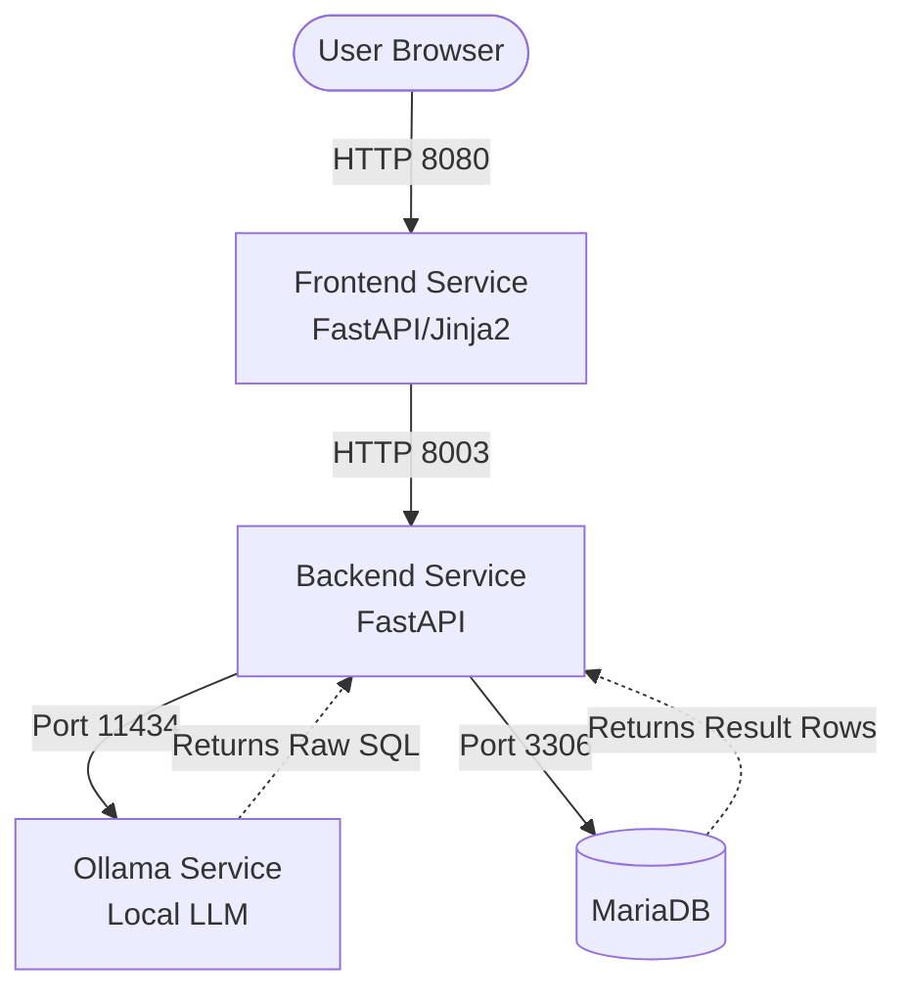

# NL-to-SQL 🗄️⚡

> **Turn natural language questions into executable MariaDB queries using a local LLM.**
>


## Overview

**NL-to-SQL** (natural language to SQL) is a lightweight, full-stack microservices application that translates human language into valid SQL queries. It bridges the gap between non-technical users and relational databases by utilizing a locally hosted Large Language Model (LLM) to infer and execute SQL statements based strictly on the target database schema and live sample data.

## Features

- 🧠 **Natural Language to SQL**: Translates user questions into SQL using a local Ollama instance (default model `gemma3:1b-it-qat`; the backend `/search` endpoint accepts a different `model`, the UI always uses the default).
- 🛡️ **SELECT-only execution**: Generated and hand-written queries pass a keyword-based check that only lets `SELECT` statements through.
- 🛠️ **Data Management**: Insert new records directly from the UI, or run your own `SELECT` queries without the LLM.
- 📊 **Schema Explorer**: Dynamically view available tables and columns in the database.
- 🎨 **Modern Developer UI**: A clean, responsive, dark-mode frontend built with FastAPI, Jinja2, and Vanilla JS.
- 🐳 **Fully Dockerized**: Simple, one-click deployment using Docker Compose.
- 🧪 **Automated Testing**: `pytest` unit tests for the SQL safety check, run in a dedicated `tester` container.

## How It Works

The system operates on a highly optimized, context-aware translation pipeline:  
`Natural Language Request → Schema Injection → Local LLM Processing → SELECT-only Check → SQL Execution → Results Presentation`

1. The FastAPI backend retrieves the live MariaDB schema along with up to three sample rows per table.
2. The schema and the user's question are injected into a few-shot prompt template whose examples act as building blocks.
3. The local Ollama LLM translates the context into raw SQL (30 s timeout per call; up to 3 attempts when Ollama returns an error status or an invalid response).
4. The backend rejects anything that is not a `SELECT` (the response is marked `unsafe`), executes the rest against MariaDB and returns the rows to the frontend.

## Example

**Natural Language Input:**
> *"show all Nolan movies and give me the exact count"*

**Generated SQL Output** (this request is also one of the few-shot examples in `backend/src/ai/prompts.py`):
```sql
SELECT m.titolo, m.anno, d.name AS director, COUNT(m.id) OVER() AS total_movies 
FROM movies m 
JOIN directors d ON m.director_id = d.id 
WHERE d.name LIKE '%Nolan%';
```

## Project Structure

The repository is organized into distinct domain boundaries and microservices:

```text
📦 NL-to-SQL
 ┣ 📂 backend                 # Python backend service
 ┃ ┣ 📂 src
 ┃ ┃ ┣ 📂 ai                  # LLM integration & prompt templates
 ┃ ┃ ┣ 📂 core                # Environment configs & settings
 ┃ ┃ ┣ 📂 db                  # MariaDB connection handlers
 ┃ ┃ ┣ 📂 schemas             # Pydantic models for request/response
 ┃ ┃ ┣ 📂 services            # SELECT-only check, query execution, data insertion
 ┃ ┃ ┗ 📜 main.py             # FastAPI entry point
 ┃ ┣ 📂 tests                 # pytest unit tests
 ┃ ┣ 📜 Dockerfile            # Multi-stage build (test and production targets)
 ┃ ┗ 📜 pyproject.toml        # Poetry dependencies
 ┣ 📂 frontend                # Web UI service
 ┃ ┣ 📂 src
 ┃ ┃ ┣ 📂 static              # CSS and Vanilla JS logic
 ┃ ┃ ┣ 📂 templates           # Jinja2 HTML views (index.html)
 ┃ ┃ ┗ 📜 main.py             # FastAPI frontend adapter
 ┃ ┣ 📜 Dockerfile            
 ┃ ┗ 📜 pyproject.toml        
 ┣ 📂 mariadb                 # Database initialization
 ┃ ┗ 📂 mariadb_init          # SQL setup scripts (.sql)
 ┣ 📂 ollama                  # LLM Engine
 ┃ ┣ 📂 scripts               # Entrypoint: starts Ollama, pulls the model on first run
 ┃ ┗ 📜 Dockerfile            # Ollama image with the custom entrypoint
 ┗ 📜 docker-compose.yaml     # Microservices orchestration
```

## Installation

Ensure you have [Docker](https://docs.docker.com/get-docker/) and [Docker Compose](https://docs.docker.com/compose/install/) installed on your machine.

```bash
# Clone the repository
git clone https://github.com/AeSoul0/NL-to-SQL.git
cd NL-to-SQL

# Build and start all microservices in detached mode
docker compose up --build -d
```

*Note: The initial build downloads the MariaDB image and builds the Python environments. On its first start the Ollama container pulls `gemma3:1b-it-qat` into the `ollama_data` volume, so the first question can take a while.*

## Running the Tests

The `tester` service builds the backend `test` target and runs `pytest -v`. It also runs once during `docker compose up`; to run it on its own:

```bash
docker compose run --rm tester
```

## Usage

Once the containers are running, access the web interface at:  
👉 **`http://localhost:8080`**

From the interface, you can:
- Use the **Search** tab to type questions in natural language.
- Use the **SQL Query** tab to test manual `SELECT` statements.
- Use the **Insert Data** tab to add new records to the database.
- Use the **Schema** tab to inspect the current database structure.

## Configuration

Environment variables are set in `docker-compose.yaml`. The values there are local development defaults; change the passwords before exposing the stack.

| Service | Variables | Purpose |
|---|---|---|
| `database` | `MARIADB_ROOT_PASSWORD`, `MARIADB_DATABASE`, `MARIADB_USER`, `MARIADB_PASSWORD` | MariaDB container setup |
| `backend`, `tester` | `DATABASE_HOST`, `DATABASE_USER`, `DATABASE_PASSWORD`, `DATABASE_NAME` | Database connection (required) |
| `backend` | `OLLAMA_API_URL` | Ollama generate endpoint, default `http://ollama:11434/api/generate` |
| `frontend` | `BACKEND_URL` | Backend address, default `http://localhost:8003` |

`OLLAMA_HOST` and `OLLAMA_REQUEST_TIMEOUT` also appear in the compose file, but the backend does not read them: the Ollama address comes from `OLLAMA_API_URL` and the request timeout is fixed at 30 s.

## Architecture

The project is divided into distinct microservices:



## Workflow Example

1. **User Request**: User clicks the shortcut *"Sci-Fi in 2014"*, which fills in *"Sci-Fi movies from 2014"*.
2. **SQL Generation**: The backend prompts Ollama with the DB schema, sample rows, and the request.
3. **Execution**: Ollama returns something like `SELECT ... WHERE m.genere LIKE '%sci-fi%' AND m.anno = 2014`.
4. **Validation & Presentation**: The backend checks that the query is a `SELECT`, runs it on MariaDB, and the frontend shows the results as a table or as JSON, both copyable (the table as TSV).

## Limitations

- **Small Model Constraints**: The system currently relies on a lightweight `1B` parameter model. To prevent hallucinations, it heavily utilizes explicit few-shot pattern matching. Complex, novel queries drastically outside the provided prompt examples may fail.
- **Read-Only LLM Pipeline**: The natural language translation is strictly designed for `SELECT` queries. Data insertion relies on explicit REST API endpoints rather than LLM inference for safety.
- **Keyword-Based Safety Check**: The `SELECT`-only check is a string match, not a SQL parser. It also rejects valid read-only queries, such as `WITH` (CTE) queries or any query containing a blocked word like `update` or `create` inside a name. The database user is not restricted to read-only access.

## Roadmap

- [x] Migrate to a modern, dark-mode developer UI with loading states on form submission.
- [x] Inject live sample data into the LLM prompt for better semantic matching.
- [x] Add "copy to clipboard" functionality for JSON and TSV table results.
- [x] Basic keyword-based `SELECT`-only check before execution.
- [ ] Proper query sanitization and sandboxing beyond the keyword check.
- [ ] Support dynamic LLM switching (e.g., swapping to a 7B parameter model) directly from the UI.

## License

© 2026 All Rights Reserved to **[AeSoul0](https://github.com/AeSoul0)**.
